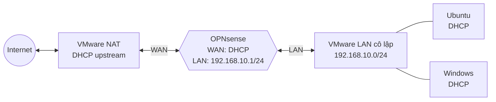

# Tuần 4: Triển khai nền tảng OPNsense trên VMware

## 1. Mục tiêu

Tuần 4 chuyển thiết kế ở Tuần 2 thành một quy trình triển khai có thể lặp lại. Phạm vi gồm tạo máy ảo OPNsense, gán đúng hai vùng mạng, cấu hình WAN/LAN, DHCP, DNS, NAT và bộ luật firewall tối thiểu. Tài liệu này là runbook triển khai và biểu mẫu nghiệm thu; các ô kết quả chỉ được cập nhật sau khi thực hiện trên hệ thống thật.

## 2. Phạm vi và giả định

- Hypervisor: VMware Workstation.
- Firewall: OPNsense cài từ DVD ISO chính thức.
- WAN: VMware NAT, nhận IPv4 bằng DHCP.
- LAN: mạng ảo cô lập, không có DHCP của VMware.
- OPNsense LAN: `192.168.10.1/24`.
- DHCP LAN: `192.168.10.100–192.168.10.199`.
- Máy khách: Ubuntu và Windows, chỉ gắn vào LAN cô lập.
- Không cấu hình port forward, DMZ, VPN, IDS/IPS hoặc web filtering trong tuần này.

## 3. Topology triển khai

OPNsense là máy duy nhất có adapter ở cả WAN và LAN. Hai máy khách không được gắn adapter trực tiếp vào VMware NAT.

## 4. Chuẩn bị và kiểm tra an toàn

1. Tải ISO từ trang phát hành chính thức và kiểm tra checksum công bố trước khi cài đặt.
2. Ghi lại tên chính xác của VMware NAT và LAN cô lập.
3. Tắt DHCP của VMware trên LAN cô lập để tránh hai DHCP server cùng cấp phát địa chỉ.
4. Xác nhận subnet VMware NAT không trùng `192.168.10.0/24`.
5. Không kết nối LAN lab vào bridge adapter của mạng vật lý.
6. Tạo snapshot trước khi thay đổi lớn; không đưa file VM, ISO, mật khẩu hoặc bản backup cấu hình chứa bí mật vào Git.

## 5. Tạo máy ảo OPNsense

| Thuộc tính | Giá trị đề xuất |
|---|---|
| Guest OS | FreeBSD 64-bit |
| vCPU | 2 |
| RAM | 4 GB; tối thiểu 3 GB |
| Disk | 20 GB thin provisioned |
| Adapter 1 | VMware NAT, dùng làm WAN |
| Adapter 2 | LAN cô lập, dùng làm LAN |
| Firmware | UEFI hoặc BIOS theo khả năng tương thích của host |

Sau khi cài đặt xong, tháo ISO khỏi ổ quang ảo và khởi động lại từ đĩa. Nếu dùng VMXNET3, cài plugin VMware theo hướng dẫn OPNsense sau khi hệ thống đã có kết nối mạng.

## 6. Gán interface và cấu hình địa chỉ

### 6.1 Nhận diện interface

Tại console OPNsense, đối chiếu MAC address trong VMware với danh sách interface để tránh đảo WAN/LAN.

| Vai trò | Adapter VMware | IPv4 |
|---|---|---|
| WAN | NAT | DHCP |
| LAN | LAN cô lập | Static `192.168.10.1/24` |

Sau khi gán, console phải hiển thị WAN có lease hợp lệ và LAN là `192.168.10.1/24`. Không tiếp tục nếu hai interface nằm cùng subnet hoặc subnet WAN trùng LAN.

### 6.2 Truy cập quản trị ban đầu

1. Gắn Ubuntu hoặc Windows vào LAN cô lập.
2. Nếu DHCP chưa hoạt động, tạm đặt địa chỉ tĩnh `192.168.10.10/24`, không cần gateway.
3. Mở `https://192.168.10.1` và kiểm tra fingerprint/chứng thư được trình duyệt hiển thị.
4. Đổi mật khẩu quản trị mặc định ngay trong lần đăng nhập đầu tiên; không ghi mật khẩu vào tài liệu hoặc Git.
5. Đặt hostname `opnsense`, domain `lab.local` và timezone `Asia/Ho_Chi_Minh`.

## 7. DHCP và DNS cho LAN

### 7.1 DHCPv4

Chỉ bật một DHCP server trên LAN với cấu hình:

| Trường | Giá trị |
|---|---|
| Interface | LAN |
| Subnet | `192.168.10.0/24` |
| Pool | `192.168.10.100–192.168.10.199` |
| Gateway | `192.168.10.1` |
| DNS server | `192.168.10.1` |
| Domain | `lab.local` |

Các phiên bản OPNsense mới có thể dùng Dnsmasq làm DHCP mặc định; tên menu có thể khác giữa phiên bản. Giá trị mạng và nguyên tắc “một DHCP server trên LAN” không thay đổi.

### 7.2 Unbound DNS

- Bật Unbound DNS.
- Giữ listen/outgoing interface ở giá trị mặc định `All` trừ khi có yêu cầu cô lập cụ thể.
- Xác nhận LAN có access list tự động cho `192.168.10.0/24`.
- Bật đăng ký DHCP lease/static mapping nếu cần phân giải hostname nội bộ và phiên bản đang dùng hỗ trợ luồng đăng ký tương ứng.
- Không mở DNS từ WAN.

## 8. NAT và firewall baseline

### 8.1 Outbound NAT

Đặt Source NAT (Outbound) ở chế độ tự động cho baseline. Xác nhận OPNsense sinh rule dịch nguồn từ `192.168.10.0/24` ra địa chỉ WAN. NAT chỉ thực hiện dịch địa chỉ; chính sách bảo mật vẫn phải do firewall rule quyết định.

### 8.2 Thứ tự luật LAN

Các luật được đánh giá theo thứ tự. Rule chặn cụ thể phải nằm trước rule cho phép tổng quát.

| Thứ tự | Action | Source | Destination | Protocol/port | Log | Mục đích |
|---:|---|---|---|---|---|---|
| 1 | Pass | `LAN net` | `This Firewall` | TCP 443 | Không bắt buộc | Quản trị HTTPS từ LAN |
| 2 | Pass | `LAN net` | `This Firewall` | TCP/UDP 53 | Không bắt buộc | DNS qua OPNsense |
| 3 | Pass | `LAN net` | `This Firewall` | ICMP echo request | Không bắt buộc | Kiểm tra gateway |
| 4 | Block | `LAN net` | Any | TCP 23 | Bật | Chặn Telnet và tạo negative test |
| 5 | Pass | `LAN net` | Any | TCP 80, 443 | Không bắt buộc | HTTP/HTTPS ra Internet |

Không thêm rule allow-any trên WAN. Return traffic của kết nối được LAN khởi tạo được xử lý bởi state table. Nếu dùng rule mặc định “LAN to any” để phục vụ giai đoạn bootstrap, phải ghi rõ là tạm thời và thay bằng bộ luật tối thiểu trước khi nghiệm thu.

## 9. Hardening tối thiểu

- Tắt web administration trên WAN; chỉ cho phép từ LAN.
- Đổi mật khẩu mặc định và dùng mật khẩu riêng cho lab.
- Tắt hardware checksum offloading, TSO và LRO theo khuyến nghị cho môi trường ảo hóa.
- Cập nhật OPNsense sau khi WAN hoạt động, sau đó tạo snapshot `week4-baseline`.
- Bật log cho các rule block dùng trong kiểm thử.
- Không cấu hình port forward trong baseline.
- Xuất backup cấu hình sau nghiệm thu, lưu ngoài Git ở vị trí được bảo vệ.

## 10. Quy trình xác minh

Thực hiện trên cả Ubuntu và Windows sau khi chuyển adapter về DHCP.

| ID | Kiểm tra | Lệnh hoặc thao tác | Kết quả đạt |
|---|---|---|---|
| W4-01 | Lease DHCP | Linux: `ip -4 addr`; Windows: `ipconfig /all` | IP thuộc pool, gateway và DNS là `192.168.10.1` |
| W4-02 | Gateway | `ping 192.168.10.1` | Có phản hồi |
| W4-03 | DNS | `nslookup example.com 192.168.10.1` | Trả về bản ghi hợp lệ |
| W4-04 | HTTP | `curl -I http://example.com` | Có HTTP response |
| W4-05 | HTTPS | `curl -I https://example.com` hoặc trình duyệt | TLS/HTTP thành công |
| W4-06 | Telnet block | `nc -vz -w 3 example.com 23` tới endpoint được phép kiểm thử | Không thiết lập kết nối; log khớp rule TCP/23 |
| W4-07 | Quản trị LAN | Mở `https://192.168.10.1` | GUI chỉ truy cập được từ LAN |
| W4-08 | WAN default deny | Kết nối có kiểm soát từ host cùng segment WAN | Bị chặn; có log khi gói tin đến OPNsense |

W4-06 cần đối chiếu firewall log hoặc packet capture; việc kết nối thất bại một mình chưa chứng minh rule OPNsense đã chặn. W4-08 cũng phải xác nhận gói tin thực sự đến WAN vì VMware NAT có thể chặn trước.

## 11. Biểu mẫu ghi nhận kết quả

| ID | Ubuntu | Windows | Thời gian | Bằng chứng | Ghi chú |
|---|---|---|---|---|---|
| W4-01 | Chưa thực hiện | Chưa thực hiện | — | — | — |
| W4-02 | Chưa thực hiện | Chưa thực hiện | — | — | — |
| W4-03 | Chưa thực hiện | Chưa thực hiện | — | — | — |
| W4-04 | Chưa thực hiện | Chưa thực hiện | — | — | — |
| W4-05 | Chưa thực hiện | Chưa thực hiện | — | — | — |
| W4-06 | Chưa thực hiện | Không bắt buộc | — | — | — |
| W4-07 | Chưa thực hiện | Chưa thực hiện | — | — | — |
| W4-08 | Không áp dụng | Không áp dụng | — | — | Cần host ở phía WAN |

Trạng thái chỉ được đổi thành “Đạt” khi kết quả và bằng chứng được thu trực tiếp từ môi trường lab.

## 12. Tiêu chí hoàn thành Tuần 4

1. OPNsense khởi động từ disk với đúng hai interface WAN/LAN.
2. WAN nhận lease DHCP và LAN sử dụng `192.168.10.1/24`.
3. Ubuntu và Windows nhận đúng DHCP option từ OPNsense.
4. DNS, HTTP và HTTPS hoạt động từ LAN qua OPNsense.
5. TCP/23 bị chặn bởi rule có log trong khi web traffic vẫn hoạt động.
6. GUI quản trị chỉ truy cập được từ LAN; WAN giữ default deny.
7. Không có DHCP rogue hoặc subnet overlap.
8. Có snapshot baseline và backup cấu hình được lưu an toàn ngoài Git.

## 13. Tài liệu tham khảo chính thức

- [Initial Installation & Configuration](https://docs.opnsense.org/manual/install.html)
- [Virtual & Cloud-Based Installation](https://docs.opnsense.org/manual/virtuals.html)
- [Interface configuration](https://docs.opnsense.org/manual/interfaces.html)
- [Firewall rules](https://docs.opnsense.org/manual/firewall.html)
- [Network Address Translation](https://docs.opnsense.org/manual/nat.html)
- [Unbound DNS](https://docs.opnsense.org/manual/unbound.html)
- [DHCP](https://docs.opnsense.org/manual/dhcp.html)

## 14. Trạng thái deliverable

Runbook triển khai, baseline policy, quy trình xác minh và tiêu chí nghiệm thu của Tuần 4 đã hoàn tất. Môi trường hiện tại chưa có máy ảo OPNsense đang chạy, vì vậy tài liệu không tuyên bố các kiểm thử đã đạt và không chứa bằng chứng giả lập.
